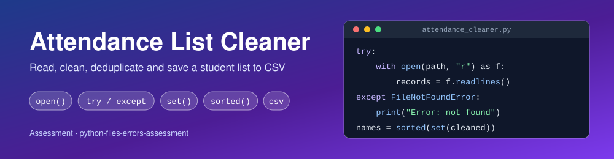
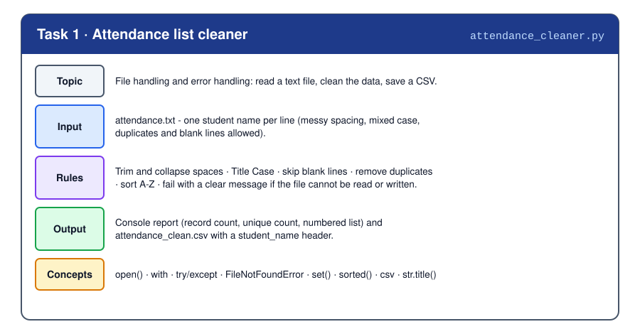
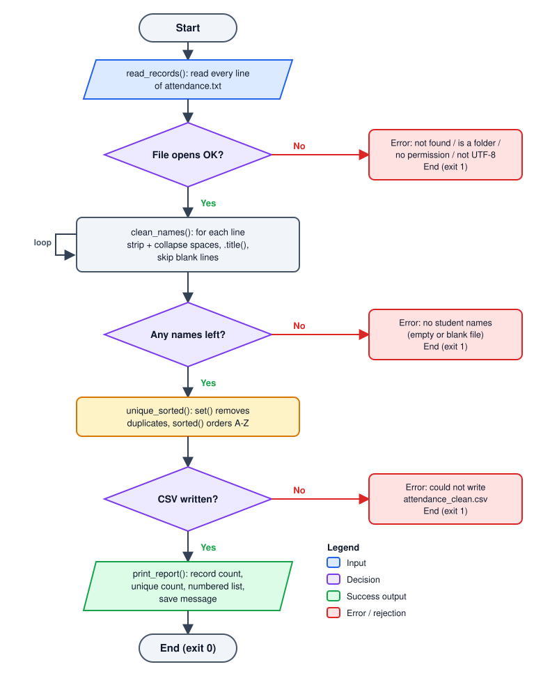
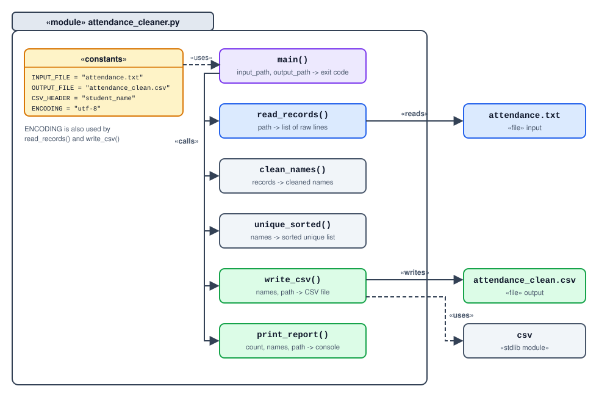

<p align="center"></p>

# Attendance List Cleaner

## 1. Project Overview

| Task | File | Topic |
|------|------|-------|
| 1 | `attendance_cleaner.py` | File handling and error handling: read a name list, clean it, remove duplicates, save to CSV |

<p align="center"></p>

## 2. Folder Structure

```text
python-files-errors-assessment/
├── assets/
│   ├── attendance_flow.svg
│   ├── banner.svg
│   ├── overview.svg
│   └── uml_diagram.svg
├── attendance.txt            # sample input
├── attendance_cleaner.py     # Task 1
└── README.md
```

`attendance_clean.csv` is created when the program runs.

## 3. Task 1: Attendance List Cleaner

**Summary.** The program reads `attendance.txt` (one student name per line), tidies every name, removes duplicates, sorts the result, prints a report and saves it to `attendance_clean.csv`.

**Rules**

- Trim spaces at both ends and collapse repeated inner spaces.
- Standardise capitalisation with `str.title()`.
- Ignore blank lines.
- Treat names that match after cleaning as duplicates and keep one.
- Sort alphabetically.
- Stop with a clear message (exit code 1) if the file cannot be read, has no names, or the CSV cannot be written.

**Program Flow**

<p align="center"></p>

**Code Methods Description**

| Method / section | Purpose |
|------------------|---------|
| Constants (`INPUT_FILE`, `OUTPUT_FILE`, `CSV_HEADER`, `ENCODING`) | File names, header text and encoding in one place |
| `read_records(path)` | Return all raw lines of the input file |
| `clean_names(records)` | Strip, collapse spaces, title-case, skip blank lines |
| `unique_sorted(names)` | Remove duplicates with `set()` and sort |
| `write_csv(names, path)` | Write the header and one quoted name per row using `csv` |
| `print_report(original_count, names, output_path)` | Print counts, numbered list and save message |
| `main(input_path, output_path)` | Run the steps, handle errors, return 0 or 1 |

**Input Validation**

- Missing file: `FileNotFoundError` is caught and a hint is shown.
- Path is a folder or has no permission: `IsADirectoryError` / `PermissionError` are caught.
- File is not valid UTF-8: `UnicodeDecodeError` is caught.
- Empty file or only blank lines: rejected before anything is written.
- Output cannot be written (for example the path is a folder): `OSError` is caught.
- Names containing commas or quotes are written safely by the `csv` module.
- Known limit: `str.title()` is not locale-aware, so "mcdonald" becomes "Mcdonald" and Turkish "YILMAZ" becomes "Yilmaz", not "Yılmaz".

**Expected Results**

- Valid input: report printed, CSV saved, exit code 0.
- Any error above: one clear message, no CSV created, exit code 1.

## 4. UML Diagram

A module diagram was chosen because the code is procedural (no classes): it shows the constants, the functions, who calls whom, and the files and library they touch.

<p align="center"></p>

## 5. Concepts and Techniques Used

- Reading and writing text files with `open()` and `with`
- Exception handling: `try` / `except` with specific exception types
- String cleaning: `strip()`, `split()`, `join()`, `title()`
- Removing duplicates with `set()` and ordering with `sorted()`
- Small single-purpose functions that return values
- CSV output with the `csv` module and `newline=""`
- Constants instead of magic values, return codes and `SystemExit`

## 6. How to Run

**Requirements:** Python 3.8 or newer (tested on 3.13). No third-party packages.

```bash
git clone https://github.com/muhammadarslan61029/python-files-errors-assessment.git
cd python-files-errors-assessment
python attendance_cleaner.py
```

Alternatives: `python3 attendance_cleaner.py` (Linux/macOS) or `py attendance_cleaner.py` (Windows).
Run it from the folder that contains `attendance.txt`.

## 7. Sample Execution

**Success** (sample `attendance.txt`, 9 lines including duplicates and blanks)

```text
Original number of records: 9
Unique student count: 4

Cleaned attendance list:
1. Ali Khan
2. Bilal Hussain
3. Sara Ahmed
4. Zainab

Cleaned list saved to 'attendance_clean.csv'.
```

`attendance_clean.csv`:

```text
student_name
"Ali Khan"
"Bilal Hussain"
"Sara Ahmed"
"Zainab"
```

**Failure: file missing**

```text
Error: 'attendance.txt' was not found.
Create the file and add one student name per line.
```

**Failure: empty file**

```text
Error: 'attendance.txt' contains no student names.
```

**Edge case: commas and quotes in names** (input `john "jj" smith` and `lee, anna`)

```text
Original number of records: 2
Unique student count: 2

Cleaned attendance list:
1. John "Jj" Smith
2. Lee, Anna

Cleaned list saved to 'attendance_clean.csv'.
```

```text
student_name
"John ""Jj"" Smith"
"Lee, Anna"
```

**Failure: invalid text encoding**

```text
Error: 'attendance.txt' is not valid utf-8 text.
```

## 8. Test Cases

All cases below were run with real input files.

| # | Scenario | Inputs | Expected result |
|---|----------|--------|-----------------|
| 1 | Normal list with duplicates, blanks, odd spacing and case | Sample `attendance.txt` | 9 records, 4 unique, sorted list, CSV saved |
| 2 | File missing | No `attendance.txt` | "was not found" message, exit 1 |
| 3 | Empty file | 0 bytes | "contains no student names", no CSV created |
| 4 | Only blank lines | Blank, spaces, tab lines | "contains no student names" |
| 5 | Single name, no trailing newline | `omar` | 1 record, 1 unique, `Omar` |
| 6 | All entries are the same name | `ali`, `ALI`, ` Ali ` | 3 records, 1 unique, `Ali` |
| 7 | Commas and quotes in names | `john "jj" smith`, `lee, anna` | Names kept, CSV quotes escaped correctly |
| 8 | Apostrophe and mixed surname | `o'brien`, `mcdonald` | `O'Brien`, `Mcdonald` |
| 9 | Invalid UTF-8 bytes | `ali` plus bytes `FF FE` | "not valid utf-8 text", exit 1 |
| 10 | Input path is a folder | `attendance.txt/` is a directory | "cannot be opened as a file", exit 1 |
| 11 | Output path is a folder | `attendance_clean.csv/` is a directory | "could not write ... (Is a directory)", exit 1 |
| 12 | Windows line endings and non-ASCII | `ayşe khan`, `AYŞE KHAN` (CRLF) | 2 records, 1 unique, `Ayşe Khan` |
| 13 | Sort order and case-insensitive duplicates | `zed`, `Amy`, `bob`, `amy` | 4 records, 3 unique: Amy, Bob, Zed |

---

**Author:** Muhammad Arslan · [GitHub](https://github.com/muhammadarslan61029/python-files-errors-assessment)
